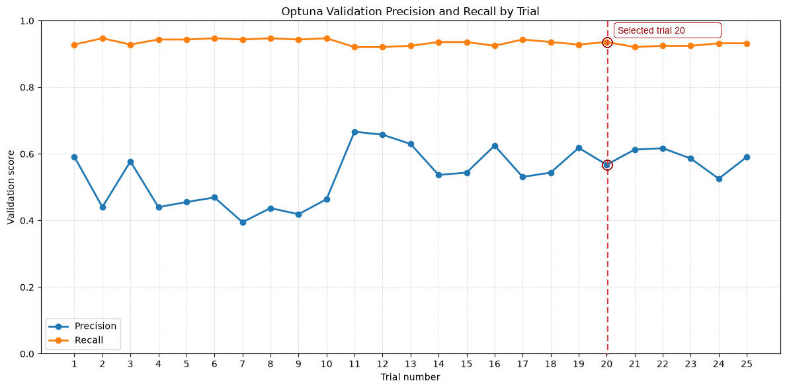

# Real-Time Fraud Transaction Detection

## Tools & Skills

[](https://www.python.org/)
[](https://kafka.apache.org/)
[](https://spark.apache.org/)
[](https://pandas.pydata.org/)
[](https://redis.io/)
[](https://xgboost.readthedocs.io/)
[](https://mlflow.org/)
[](https://fastapi.tiangolo.com/)
[](https://www.docker.com/)
[](https://jupyter.org/)

This project builds an end-to-end real-time fraud detection pipeline for credit-card transactions using Python, Kafka, Docker, PySpark, Redis, XGBoost, MLflow, FastAPI, and Jupyter notebooks. The pipeline covers transaction ingestion and stream processing, feature engineering, model training with Optuna hyperparameter tuning, and a FastAPI-based real-time inference service.

## Contents

- [Overview](#overview)
- [Project Status — Final Summary](#project-status--final-summary)
- [Daily Development Log](#daily-development-log)
- [High-Level Architecture](#high-level-architecture)
- [Project Workflow](#project-workflow)
- [Repository Structure](#repository-structure)
- [Prerequisites](#prerequisites)
- [Local Setup](#local-setup)
- [Kafka Management Commands](#kafka-management-commands)
- [Notes](#notes)

---

## Overview

This project builds a real-time fraud detection pipeline for credit-card transactions. It combines:

- a Kafka-based event streaming layer,
- PySpark stream processing with feature engineering,
- a Redis sliding-window feature store,
- an XGBoost model trained and tracked with MLflow/DagsHub,
- and a FastAPI inference service that scores transactions in near real time.

The goal is to transform raw transaction history into a streaming architecture that supports near-real-time risk detection and downstream decisioning.

---

## Project Status — Final Summary

The project is **complete**. All major pipeline stages have been implemented and validated end-to-end:

| Stage | Status |
|---|---|
| Kafka event ingestion | ✅ Complete |
| PySpark stream processing & feature engineering | ✅ Complete |
| Redis sliding-window feature store | ✅ Complete |
| Feature selection (fill-rate, near-zero-variance, IV) | ✅ Complete |
| Baseline XGBoost model training + MLflow logging | ✅ Complete |
| Challenger model development + Optuna tuning | ✅ Complete |
| FastAPI real-time inference service | ✅ Complete |

### Final Model Performance (XGBoost, Optuna-tuned — Trial 20)

The champion model was selected from Optuna trial 20 based on the precision/recall tradeoff across all trials. At a prediction threshold of 0.5:

| Metric | Validation | Test |
|---|---:|---:|
| Precision (fraud) | 56.75% | 57.38% |
| Recall (fraud) | 93.58% | 92.45% |
| F1 (fraud) | 70.66% | 70.81% |
| Accuracy | 99.40% | 99.42% |
| ROC-AUC | 0.9970 | 0.9973 |
| PR-AUC (Avg Precision) | 0.9207 | 0.9158 |

**Optuna best parameters:**

| Parameter | Value |
|---|---:|
| `n_estimators` | 1,374 |
| `max_depth` | 6 |
| `learning_rate` | 0.02246 |
| `subsample` | 0.6435 |
| `colsample_bytree` | 0.9246 |

The dataset contains ~326,000 transactions with a 0.76% fraud rate. ROC-AUC and PR-AUC were the primary tuning metrics given the extreme class imbalance; Gini is not a reliable signal for this problem.

Track all model runs and metrics on [DagsHub MLflow](https://dagshub.com/vijaytakbhate2002/credit-card-fraud-transaction-model/experiments).

---

## Daily Development Log

<details open>
<summary><strong>Development Update - 2026-10-11</strong></summary>

- Optuna tuning improved challenger precision by approximately 3–4% compared with the previous model. Trial 20 was selected from the precision/recall tradeoff: **56.8% validation precision** and **93.6% validation recall**.
- Tuned XGBoost parameters recorded in [model_development/model_development.ipynb](model_development/model_development.ipynb):

  | Parameter | Value |
  |---|---:|
  | `n_estimators` | 1,374 |
  | `max_depth` | 6 |
  | `learning_rate` | 0.0224645857538804 |
  | `subsample` | 0.643516540558006 |
  | `colsample_bytree` | 0.924602360960554 |

- Track model runs and metrics in the [MLflow experiments](https://dagshub.com/vijaytakbhate2002/credit-card-fraud-transaction-model/experiments).
- Precision and recall across all completed trials are shown below; trial 20 is selected.



</details>

<details open>
<summary><strong>Development Update - 2026-10-10</strong></summary>

- Trained a baseline XGBoost model and logged its parameters, metrics, and model artifact to MLflow. Built and tuned a challenger XGBoost model for comparison.
- Fraud represents only 0.76% of the data. Because of this imbalance, XGBoost validation uses ROC-AUC and PR-AUC (precision-recall AUC) as primary metrics; Gini / standard AUC are not reliable signals here.
- Increased the challenger model's `n_estimators` from 500 to 1,500 and reduced `learning_rate` from 0.05 to 0.02. Precision improved from 49.0% to 52.9%, a gain of 3.9 percentage points.
- At 52.9% precision, about 47.1% of predicted fraud cases are legitimate transactions, so false positives still require substantial review effort. The next tuning focus is reducing False Discovery Rate (FP / (FP + TP)) and improving precision while retaining fraud capture.

</details>

<details open>
<summary><strong>Development Update - 2026-10-07</strong></summary>

- Completed feature selection in [model_development/feature_selection.ipynb](model_development/feature_selection.ipynb) using fill-rate analysis, near-zero-variance screening, and information value (IV) filtering.
- Evaluated 326,799 transactions across 28 columns. Fill-rate analysis found no columns below the 90% threshold; near-zero-variance screening flagged one column, and IV filtering retained 17 features at the 0.2 threshold.
- The combined report retains 17 predictor features and the `is_fraud` target, while dropping 10 predictors. The target is preserved as the label for supervised learning.
- Next step: use the selected predictor features for model development and training.

</details>

<details>
<summary><strong>Development Update - 2026-10-04</strong></summary>

- Added a separate Spark streaming session in `fraud_streaming/spark/feature_analysis.ipynb` to periodically read the current feature-store window from Redis and compute analytical metrics (transaction count, total amount, average amount, category distribution).
- Added a dedicated Redis analytics client (`RedisAnalyticsIntegration`) to store the latest computed metrics for downstream consumption.

</details>

<details>
<summary><strong>Development Update - 2026-10-03</strong></summary>

- Integrated Redis with the Spark streaming flow and completed an initial end-to-end integration test.
- Streamed transaction cases with `producer.py` using a 1-second delay, processed the real-time data, and stored basic metrics (`batch_id`, `total_records`, `fraud_count`) in Redis.
- Checked values with `HGETALL fraud:metrics:latest` and confirmed that the metrics updated as expected.
- This was a flow and integration check. `fraud_count` is included only for this experiment; in the production-ready flow it should be written to Redis after model prediction, rather than before prediction.

</details>

<details>
<summary><strong>Development Update - 2026-09-30</strong></summary>

- Tuned the Kafka producer rate and Spark's `maxOffsetsPerTrigger` to find a working balance: the producer sent 2,000 records per second while Spark processed batches capped at 10,000 offsets.
- Spark kept up with the stream and wrote the processed data to Parquet.
- Processed nearly 300,000 data points, which were used to train the machine-learning model in the next step.

</details>

<details>
<summary><strong>Development Update - 2026-09-28</strong></summary>

- Configured a local Kafka broker using Docker in [fraud_streaming/kafka/docker-compose.yml](fraud_streaming/kafka/docker-compose.yml).
- Added a transaction replay producer that reads the CSV dataset and publishes rows to the `transaction-stream` topic in [real_time_data_producer/producer.py](real_time_data_producer/producer.py).
- Documented Kafka topic operations and cleanup steps in [commands.md](commands.md).
- Established the project structure for stream-processing and feature-generation work.

</details>

---

## High-Level Architecture

```text
CSV / Parquet transaction data
            |
            v
Python event producer  (real_time_data_producer/producer.py)
            |
            v
Kafka topic: transaction-stream  (Docker, apache/kafka:4.0.1)
            |
            v
PySpark Structured Streaming  (fraud_streaming/spark/)
  - type casting & null filtering
  - deduplication on trans_num
  - feature engineering: transaction_hour, day_of_week,
    is_weekend, amt_log1p, distance_km (Haversine)
            |
       _____|_____
      |           |
      v           v
  Parquet      Redis sliding-window feature store
  (processed)  (fraud_streaming/redis/)
                   |
                   v
           Offline model training
           - Feature selection (IV, fill-rate, NZV)
           - XGBoost + Optuna hyperparameter tuning
           - MLflow / DagsHub experiment tracking
                   |
                   v
           FastAPI inference service  (app.py)
           - Champion model loaded from MLflow registry
           - POST /predict → fraud probability + label
           - GET  /health  → liveness check
                   |
                   v
       Risk decision: approve / reject / challenge
```

---

## Project Workflow

### 1. Data Ingestion

Historical transaction data (`credit_card_transactions.csv`) is loaded and replayed row-by-row as serialized Kafka events by `real_time_data_producer/producer.py`. Configurable `--interval`, `--topic`, and `--bootstrap-servers` flags allow rate control.

### 2. Stream Processing & Feature Engineering

PySpark Structured Streaming (`fraud_streaming/spark/`) consumes the `transaction-stream` topic. Each micro-batch is:
- type-cast and null-filtered,
- deduplicated on `trans_num`,
- enriched with derived features: `transaction_hour`, `transaction_day_of_week`, `is_weekend`, `amt_log1p`, and `distance_km` (Haversine formula from card-holder to merchant coordinates).

Processed batches are written to Parquet and to the Redis feature store in parallel.

### 3. Redis Sliding-Window Feature Store

`fraud_streaming/redis/redis_integration.py` maintains a time-indexed sorted set (`fraud:features:window`) backed by per-transaction JSON strings with TTL-based expiry. The `RedisAnalyticsIntegration` class reads the active window and publishes aggregate metrics (transaction count, total/average amount, category breakdown) to a separate analytics hash (`fraud:analytics:window`).

### 4. Feature Selection

[`model_development/feature_selection.ipynb`](model_development/feature_selection.ipynb) evaluated 326,799 transactions across 28 columns using three sequential filters:
1. **Fill-rate analysis** — no column fell below the 90% threshold.
2. **Near-zero-variance screening** — one column flagged and dropped.
3. **Information value (IV) filtering** — 17 features retained at the 0.2 threshold.

The 17 selected features and the `is_fraud` target are recorded in `model_development/artifacts/selected_features.json`.

### 5. Model Training & Tuning

[`model_development/model_development.ipynb`](model_development/model_development.ipynb) and [`model_development/challenger_model_development.ipynb`](model_development/challenger_model_development.ipynb) cover:
- **Baseline XGBoost** logged to MLflow with parameters, metrics, and model artifact.
- **Challenger XGBoost** with progressive hyperparameter adjustments.
- **Optuna** multi-objective search (precision + recall) over 20+ trials. Trial 20 was selected: 56.8% validation precision at 93.6% recall.

All experiments are tracked at [DagsHub MLflow](https://dagshub.com/vijaytakbhate2002/credit-card-fraud-transaction-model/experiments).

### 6. Real-Time Inference

[`app.py`](app.py) is a FastAPI service that:
- Loads the champion model from the MLflow model registry (`models:/FraudDetectionModel@champion`) via DagsHub.
- Exposes `GET /health` for liveness checks.
- Exposes `POST /predict` — accepts a JSON feature dict and returns `prediction`, `label` (`fraud` / `legitimate`), `fraud_probability`, and `model_url`.

---

## Repository Structure

```text
real_time_fraud_transaction_detection/
|-- README.md
|-- app.py                            # FastAPI inference service
|-- commands.md                       # Kafka & Redis operational commands
|-- execution_steps.md                # Pipeline execution walkthrough
|-- requirements.txt
|-- data.dvc
|-- data/
|   |-- checkpoints/                  # Spark streaming checkpoints
|   |-- processed/                    # Parquet output from Spark
|   `-- raw_input/
|       `-- credit_card_transactions.csv
|-- fraud_streaming/
|   |-- kafka/
|   |   `-- docker-compose.yml        # Single-node KRaft Kafka broker
|   |-- redis/
|   |   |-- config.py                 # Redis host, port, key constants
|   |   `-- redis_integration.py      # Feature store & analytics clients
|   `-- spark/
|       |-- config.py                 # Processed data & checkpoint paths
|       |-- feature_analysis.ipynb    # Analytics over Redis feature window
|       |-- transaction_data_processing.ipynb
|       `-- src/
|           |-- data_processing.py    # Batch processing, feature engineering
|           `-- schema.py             # Kafka message schema
|-- model_development/
|   |-- feature_selection.ipynb
|   |-- model_development.ipynb
|   |-- challenger_model_development.ipynb
|   |-- artifacts/
|   |   |-- classification_reports.json
|   |   |-- confusion_matrix_test.csv
|   |   |-- confusion_matrix_validation.csv
|   |   |-- evaluation_metrics.json
|   |   |-- evaluation_metrics.csv
|   |   |-- feature_importance.csv
|   |   |-- optuna_best_parameters.json
|   |   |-- optuna_precision_recall_tradeoff.svg
|   |   |-- optuna_precision_recall_trials.csv
|   |   |-- selected_features.json
|   |   `-- xgboost_fraud_model.json
|   `-- feature_selection_report/
|       `-- feature_selection_report.csv
|-- real_time_data_producer/
|   `-- producer.py                   # CSV-to-Kafka event replay producer
|-- readme_artifacts/
|   `-- output.png                    # Optuna precision/recall tradeoff plot
`-- .gitignore
```

---

## Prerequisites

- Python 3.10+
- Docker Desktop (for Kafka and Redis containers)
- Java 11+ (required by PySpark)
- Python virtual environment (`dev_env/` is included)

---

## Local Setup

### 1. Start Kafka

From the project root:

```bash
docker compose -f fraud_streaming/kafka/docker-compose.yml up -d
```

### 2. Activate the Python environment

```bash
./dev_env/Scripts/activate
```

On PowerShell:

```powershell
.\dev_env\Scripts\Activate.ps1
```

### 3. Run the producer

```bash
python real_time_data_producer/producer.py --interval 0.0005
```

This reads the CSV from `data/raw_input/credit_card_transactions.csv` and publishes each row to the `transaction-stream` topic. Adjust `--interval` to control replay speed.

### 4. Run PySpark stream processing

Open and run `fraud_streaming/spark/transaction_data_processing.ipynb` to start consuming the Kafka stream, applying feature engineering, and writing output to Parquet and Redis.

### 5. Consume messages from Kafka (optional debug)

```bash
docker exec -it kafka /opt/kafka/bin/kafka-console-consumer.sh \
  --topic transaction-stream \
  --bootstrap-server localhost:9092 \
  --from-beginning
```

### 6. Start the inference API

```bash
uvicorn app:app --reload
```

Send a prediction request:

```bash
curl -X POST http://localhost:8000/predict \
  -H "Content-Type: application/json" \
  -d '{"features": {"amt": 150.0, "transaction_hour": 14, ...}}'
```

---

## Kafka Management Commands

Operational notes for topic cleanup and retention resets are in [commands.md](commands.md).

Common examples:

```bash
# Delete topic
docker exec -it kafka /opt/kafka/bin/kafka-topics.sh \
  --bootstrap-server localhost:9092 --delete --topic transaction-stream

# Recreate topic
docker exec -it kafka /opt/kafka/bin/kafka-topics.sh \
  --bootstrap-server localhost:9092 --create --topic transaction-stream \
  --partitions 1 --replication-factor 1
```

---

## Notes

This project demonstrates a complete end-to-end real-time fraud detection pipeline — from raw CSV data through Kafka streaming, PySpark feature engineering, Redis feature storage, XGBoost model training with Optuna tuning, MLflow experiment tracking, and a FastAPI inference service. The final champion model achieves 56.8% precision at 93.6% recall on validation data, with a ROC-AUC of 0.997, optimized to maximize fraud capture while keeping false positives manageable for a dataset with 0.76% fraud prevalence.
